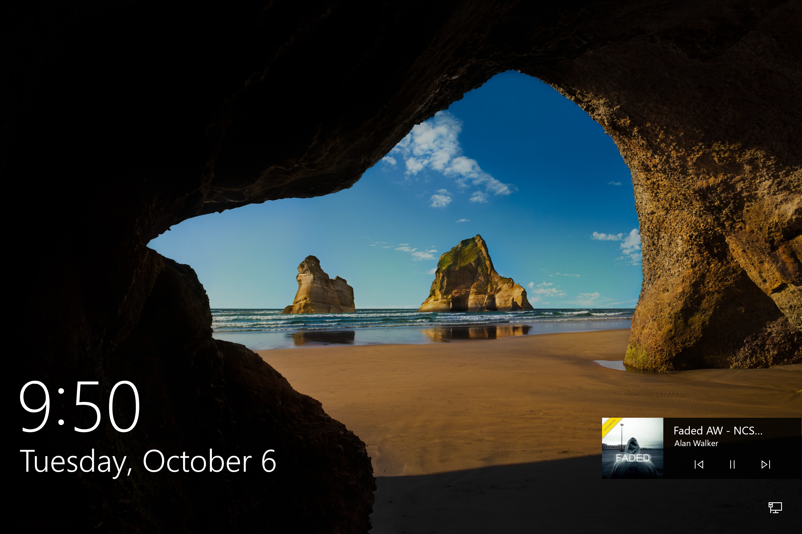
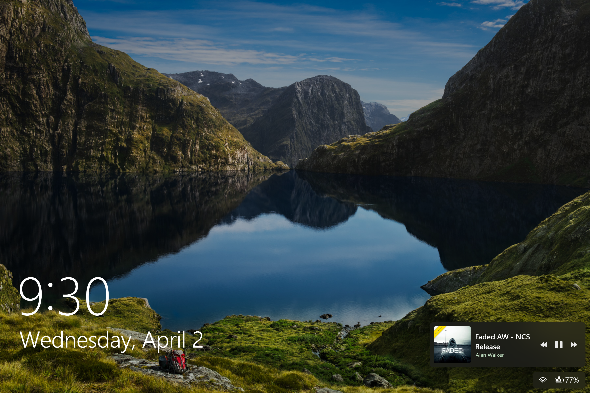
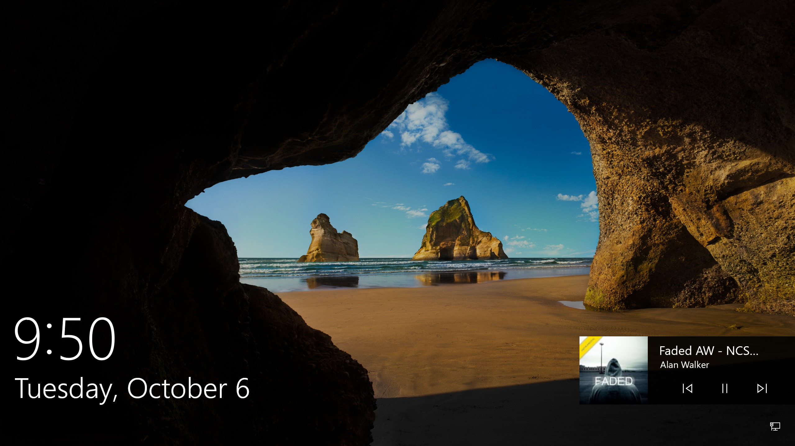
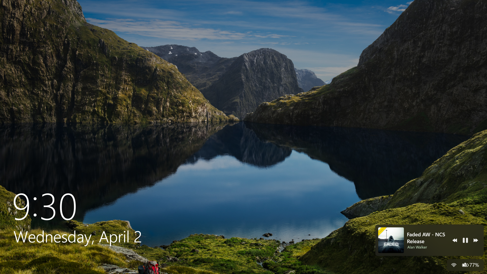
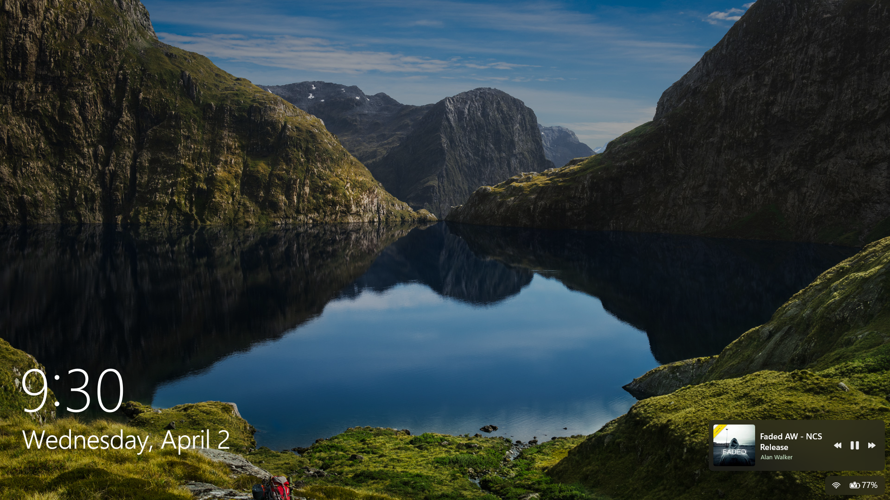
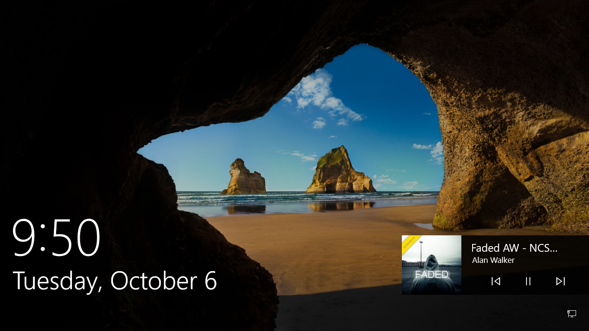
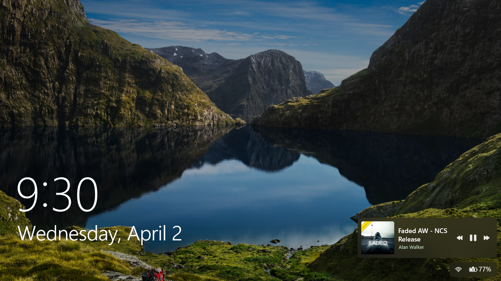

# Windows 10L - Lock Screen
Tutorial for bringing back Windows 10 Lock Screen to Windows 11

Forked from https://github.com/Acercandr0/Solid-Mist Thank you.

## Table of contents
◇ [README (You are currently here)](https://github.com/JayeND-03/Windows-10L-LockScreen/blob/main/README.md)

◇ [Installation](https://github.com/JayeND-03/Windows-10L-LockScreen/blob/main/Installation.md)

◇ Limitations

◇ Previews

# Limitations
## First logon
Every time you boot up your system, it will still show up the Windows 11 Lockscreen, just like on [Samsung and some Android devices](https://www.reddit.com/r/oneui/comments/1m78jtl/why_when_i_boot_up_my_phone_it_shows_the_time/).

Just login to the desktop and Windhawk will start automatically to apply the tweaks, Windows 10 Lockscreen should be back then.
## Media Flyout
The pause/play, previous and next buttons are hard-coded, therefore there is currently no way to make it stay under the song&author title names.
## Tested builds
I haven't tested all the builds way from 21H2. So help me if you can, appreciate it.
✅[Experimental] 26H2 - 26300.8289 up to 26340.9843
⁉️[Not tested] Beta&RP of 26H2 should work
⚠️[Not tested] Windows 11 21H2 to 26120.5761 (Beta Channel)
❌[Incompatible] Windows 11 builds below 21H2
# Previews
Date&Time is fully scaled perfectly and automatically, along with Media Flyout and Network&Battery tray.
|Windows 10 (1809)|Windows 11 (26H2)|
|--|--|
|2880x1920 (SP9)|  |
| | |
|2560x1440 (2K)| |
| | |
|1920x1080 | |
| | |
|1366x768 | |
| | |
